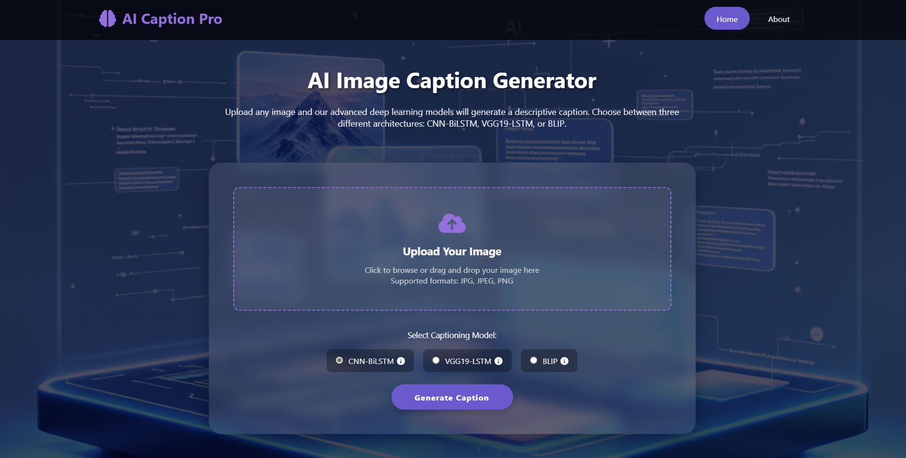
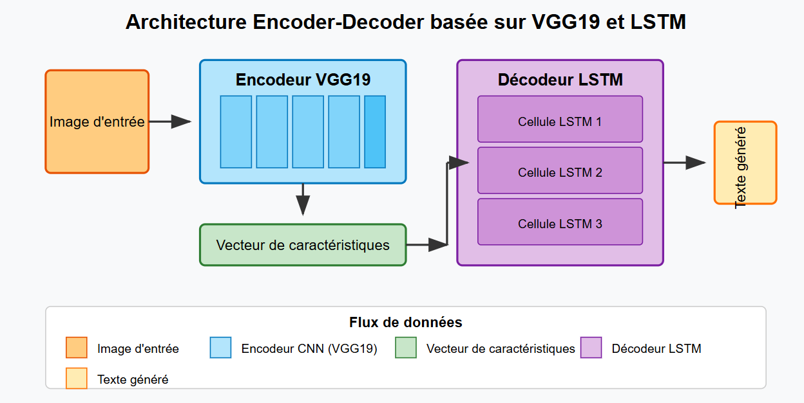
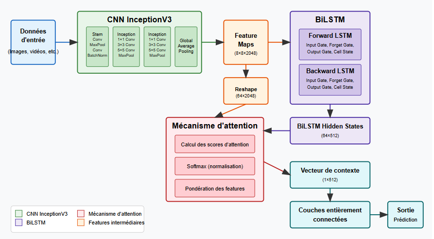
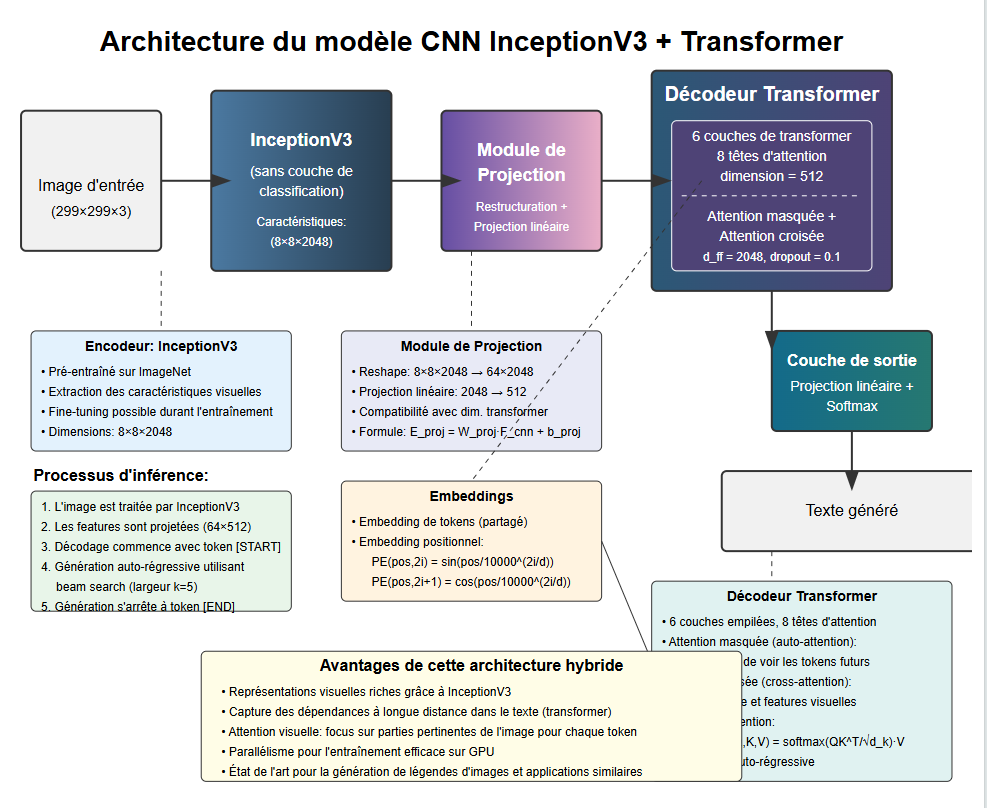
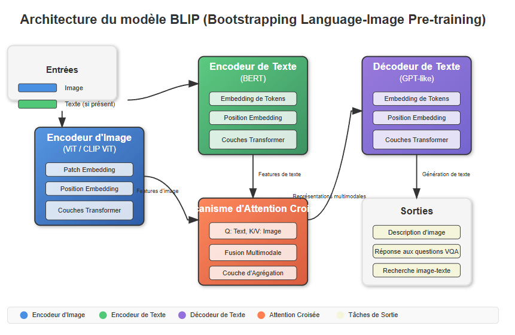
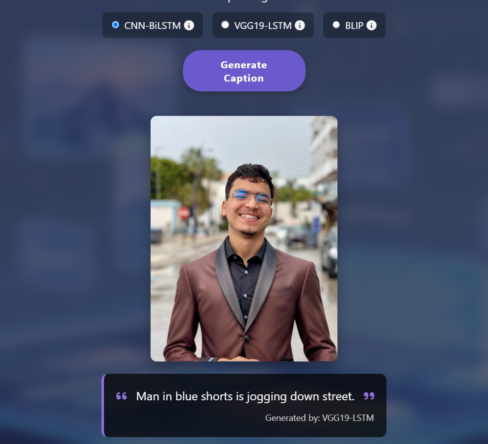
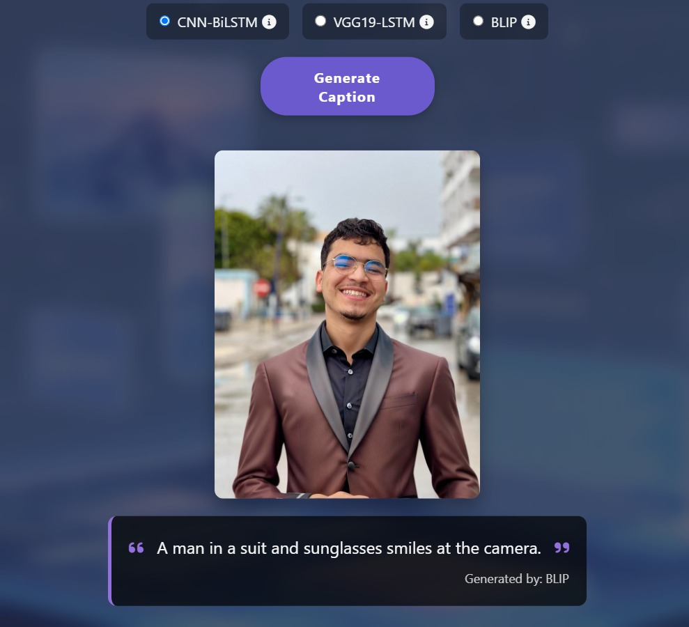
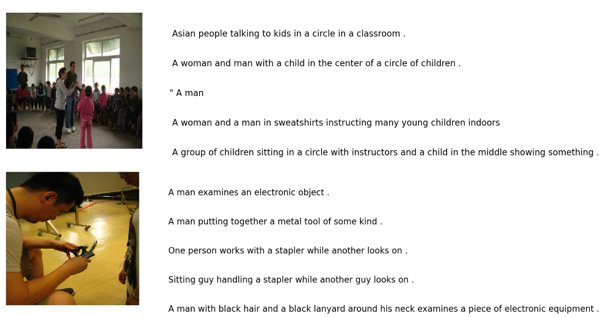

 <div align="center">


# Image Captioning with Deep Learning

**CNN–LSTM/BiLSTM, Transformer & BLIP — Flask Web Application**


*Machine Learning Project — Big Data & Artificial Intelligence*  
*ENSA Tétouan | Academic Year 2024–2025*

</div>

---

## Overview

This project explores **automatic image captioning** using deep learning. It compares several image-to-text architectures on the **Flickr30k dataset**, ranging from CNN-based encoder–decoder models to Transformer-based architectures and the pretrained BLIP model.

The project also includes a **Flask web application** that allows users to upload an image, select an available captioning model, and generate a natural-language description.

The evaluated approaches are:

- **VGG19 + LSTM**
- **InceptionV3 + BiLSTM**
- **InceptionV3 + Transformer**
- **BLIP** — pretrained vision-language model

The models are evaluated using BLEU scores to compare the quality of their generated captions.

<div align="center">
  
  <br/>
  <em>Home page of the Flask application</em>
</div>

## Features

- Image upload with drag-and-drop support (JPG and PNG, up to 16 MB).
- Model selection through the web interface.
- Caption generation using greedy decoding for the trained encoder–decoder models.
- Support for three models in the application: VGG19-LSTM, CNN-BiLSTM and BLIP.
- Conditional BLIP loading, allowing the application to run without PyTorch when BLIP is not selected.
- Automatic loading of pretrained BLIP weights from Hugging Face.
- Model evaluation using BLEU-1 and BLEU-4 metrics.

## Model Architectures

### Model Comparison

| Model | Visual Encoder | Text Decoder | Main Characteristics |
|---|---|---|---|
| **VGG19 + LSTM** | VGG19 (`fc2`, 4096 features) | Embedding + LSTM | Feature-vector encoder–decoder |
| **InceptionV3 + BiLSTM** | InceptionV3 (2048 features) | Embedding + BiLSTM (256) | Batch normalization and feature concatenation |
| **InceptionV3 + Transformer** | InceptionV3 (8×8×2048 feature maps) | Transformer (6 layers, 8 heads, d=512) | Cross-attention between image and text features |
| **BLIP** | Vision Transformer (ViT) | BERT-based text decoder | Pretrained vision-language architecture |

### Architecture Diagrams

<div align="center">

| VGG19 + LSTM | InceptionV3 + BiLSTM |
|:---:|:---:|
|  |  |
| InceptionV3 + Transformer | BLIP |
|  |  |

</div>

### Trained Model Files

The following files are required by `app.py` for the locally trained models. They must be placed inside the `models/` directory.

| File | Description |
|---|---|
| `model_checkpoint.h5` | InceptionV3-BiLSTM model (`max_length=74`) |
| `tokenizer.pkl` | Keras tokenizer associated with the BiLSTM model |
| `vgg19_model.h5` | VGG19-LSTM model (`fc2`, 4096 features, `max_length=75`) |
| `vgg19_tokenizer.pkl` | Keras tokenizer associated with the VGG19 model |

**BLIP** uses `Salesforce/blip-image-captioning-base`, which is downloaded automatically from Hugging Face when first selected.

## Results

Evaluation was performed on the test set, corresponding to 10% of the Flickr30k dataset.

| Model | BLEU-1 | BLEU-4 |
|---|:---:|:---:|
| VGG19 + LSTM | 0.5832 | 0.1720 |
| InceptionV3 + BiLSTM | 0.6037 | 0.1968 |
| InceptionV3 + Transformer | 0.6132 | 0.2114 |
| **BLIP** | **0.7980** | **0.2690** |

BLIP achieves the highest scores among the evaluated approaches. Its pretrained vision-language representation provides a substantial improvement over the trained CNN–RNN architectures.

The InceptionV3-Transformer also outperforms the two LSTM-based approaches, illustrating the benefits of attention-based decoding in this experiment.

For the detailed experimental analysis, consult the [project report](docs/rapport_projet_ML.pdf), particularly Sections 6 and 7.

### Application Examples

<div align="center">

| VGG19 + LSTM | BLIP |
|:---:|:---:|
|  |  |

</div>

## Dataset

The project uses **Flickr30k**, a dataset containing approximately:

- 31,783 images.
- Five human-written captions per image.
- Approximately 158,915 captions in total.

**Dataset source:** [Flickr30k on Kaggle](https://www.kaggle.com/datasets/adityajn105/flickr30k)

Dataset download and organization instructions are provided in [`data/README.md`](data/README.md).

<div align="center">
  
  <br/>
  <em>Examples from the Flickr30k dataset</em>
</div>

### Text Preprocessing

The caption preprocessing pipeline includes:

1. Converting captions to lowercase.
2. Removing single-character words.
3. Adding `startseq` and `endseq` tokens.
4. Tokenization using the Keras `Tokenizer`.
5. Padding sequences to the required maximum length.

The vocabulary contains approximately 18,319 words, with a maximum sequence length of 74 for the InceptionV3-BiLSTM model.

## Project Structure

```text
image-captioning-flickr30k/
│
├── .gitignore
├── app.py
├── requirements.txt
│
├── notebooks/
│   ├── 01_cnn_bilstm_inceptionv3.ipynb
│   └── 02_vgg_lstm.ipynb
│
├── templates/
│   ├── home.html
│   └── about.html
│
├── static/
│   ├── images/
│   │   ├── background.png
│   │   └── ai-vision.png
│   └── uploads/
│
├── models/
│   ├── model_checkpoint.h5
│   ├── tokenizer.pkl
│   ├── vgg19_model.h5
│   └── vgg19_tokenizer.pkl
│
├── data/
│   └── README.md
│
└── docs/
    ├── rapport_projet_ML.pdf
    ├── images/
    │   ├── logo_ensa_tetouan.png
    │   ├── archi_vgg19_lstm.png
    │   ├── archi_inceptionv3_bilstm.png
    │   ├── archi_inceptionv3_transformer.png
    │   ├── archi_blip.png
    │   └── flickr30k_exemples.png
    │
    └── screenshots/
        ├── interface_home.png
        ├── demo_vgg19_lstm.png
        └── demo_blip.png
```

*Note: Model weights, tokenizer files, and the Flickr30k dataset are not included in the repository. The structure above illustrates the expected local organization.*

## Installation & Usage

### 1. Clone the Repository

```bash
git clone https://github.com/<your-username>/Deep-Learning-Based-Image-Captioning-Using-Flickr30K.git
cd image-captioning-flickr30k
```

### 2. Create a Virtual Environment

```bash
python -m venv venv
```

Activate it:

```bash
# Linux / macOS
source venv/bin/activate

# Windows
venv\Scripts\activate
```

### 3. Install Dependencies

```bash
pip install -r requirements.txt
```

### 4. Prepare the Models

Create the `models/` directory if it does not exist:

```bash
mkdir models
```

Place the trained model files and their corresponding tokenizers inside this directory:

```text
models/
├── model_checkpoint.h5
├── tokenizer.pkl
├── vgg19_model.h5
└── vgg19_tokenizer.pkl
```

The model files must correspond to the architectures and tokenizers expected by `app.py`.

BLIP does not require manually downloaded model weights. Its pretrained model is retrieved automatically from Hugging Face when selected for the first time.

### 5. Run the Application

```bash
python app.py
```

Open the following address in your browser:

[http://127.0.0.1:5000](http://127.0.0.1:5000)

### Optional Environment Variables

| Variable | Purpose |
|---|---|
| `SECRET_KEY` | Flask session secret key |
| `FLASK_DEBUG=1` | Enable Flask debug mode |

**Note:** Internet access is required for the first download of pretrained ImageNet weights and BLIP model files.

## Training & Experimental Setup

The notebooks document the training workflow for the CNN-based models:

1. Visual feature extraction.
2. Caption preprocessing and tokenization.
3. Data generator preparation.
4. Model training.
5. Caption generation and BLEU evaluation.

### Hyperparameters

| Parameter | VGG19 + LSTM | InceptionV3 + BiLSTM | InceptionV3 + Transformer |
|---|:---:|:---:|:---:|
| Batch size | 64 | 16 | 64 |
| Learning rate | 1e-4 | 1e-4 | 5e-5 |
| Epochs | 20 | 20 | 20 |
| Training time | 7 h | 10 h | 7 h |

*Reported training environment: NVIDIA Tesla V100 GPU on Kaggle.*

**Training configuration:**
- Loss function: Categorical cross-entropy.
- Optimizer: Adam.

**Notebook scope:** `02_vgg_lstm.ipynb` is the original VGG-based prototype, developed with VGG19 and Flickr8k. The deployed VGG19-LSTM model follows the same general approach but uses Flickr30k.

The InceptionV3-Transformer notebook is not included in the repository; its experimental results are documented in the project report.

## Future Improvements

Potential extensions include:

- Additional evaluation metrics such as CIDEr and METEOR.
- Beam search decoding.
- Fine-tuning BLIP on Flickr30k.
- Training on additional datasets such as MS COCO and Visual Genome.
- Multilingual image caption generation.

## Authors

- **Abdessamad Ait Brahim**
- **Ayyoub Amazal**
- **Yassir Lagnaoui**

**Academic Supervisor:** Dr. Imane Hachchane

**Institution:** École Nationale des Sciences Appliquées de Tétouan (ENSA Tétouan)  
**Program:** Big Data & Artificial Intelligence  
**Academic Year:** 2024–2025

## References

1. Vaswani et al. — [Attention Is All You Need](https://arxiv.org/abs/1706.03762).
1. Keras — [Image Captioning with Visual Attention](https://keras.io/examples/vision/image_captioning/).
2. Flickr30k — [Dataset on Kaggle](https://www.kaggle.com/datasets/adityajn105/flickr30k).

---

<div align="center">

**Image Captioning with Deep Learning — ENSA Tétouan, 2024–2025**

</div>